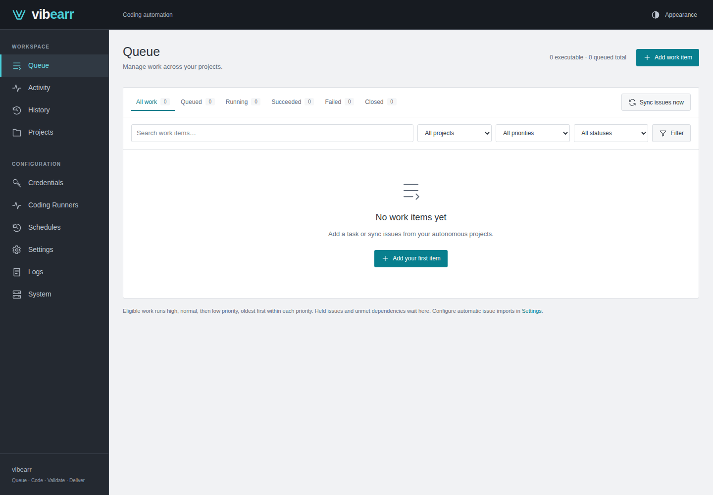

# Vibearr

A self-hosted *arr app for coding work with Codex, Claude Code, and OpenCode.
Vibearr imports GitHub issues, schedules isolated work, records checks and reviews,
and delivers pull requests for a human to merge.

The stack has **four persistent containers**: `app`, `postgres`, `runner`, and
`worker`. Test databases, candidate applications and browsers run temporarily
inside the execution worker. No Docker daemon or host checkout is available to
runtime code. See the [architecture](docs/architecture.md).



## Start with Docker

Docker Engine and Compose are the runtime prerequisites. All application, Git,
coding, migration, test, packaging, browser and recovery processes run in Docker.

```sh
cp .env.example .env
bash run.sh --build
docker compose run --rm app python manage.py createsuperuser
```

Open [localhost:7777](http://127.0.0.1:7777/). Fresh initialization generates
credentials in private named volumes. The runner starts with processing disabled.
The app supervises its web server and durable issue-import scheduler; no separate
queue broker or scheduling service is needed.

This revision uses the Vibearr database, volume and configuration names and a fresh
initial schema. It does not migrate older installations or support legacy command,
module, environment-variable or filesystem aliases.

See [Docker operations](docs/docker-operations.md) for subscription login, external
Ollama, qualification, backup and restoration. Codex and Claude Code use selected
subscription logins; OpenCode uses an operator-provided Ollama server and installed
model. Starting Vibearr never calls a paid model, starts Ollama, or downloads a model.

## Configure work

1. Add a project with its HTTPS GitHub repository URL and base branch.
2. Select a GitHub issue-import credential in Settings. Enable Autonomous on the
   project to discover issues, or add work directly through the queue.
3. Configure a coding runner, its schedule, provider, model and selected credentials.
   Repository publication credentials and issue-read grants remain separate.
4. Qualify the actual worker boot and selected account/model before enabling work.

The queue, Activity, History, System and configuration pages show task progress,
saved artifacts, delivery links and actionable failures. Configuration changes
do not qualify an account or grant task permissions.

This is a single-user application for a private network. The browser UI has no
login requirement. Admin access and bearer-authenticated APIs have separate
credentials. Keep it on a private network or behind an authenticated proxy.

## Factory workflow

```text
Issue → Intake → Specification → Build → Trusted checks → Reviews → Decision → PR → Human merge
```

Only the builder may change candidate source. Code review always runs; trusted
changed paths route security and UI/UX reviews. Repairs share a frozen bounded
budget, including an explicit zero-repair setting. New candidates require fresh
checks and reviews. See [factory execution](docs/software-factory-plan.md) and
[review routing](docs/factory-routing.md).

**Humans merge every PR.** Automatic merging is not supported.
Engineering qualification, fixture tests and agent
review do not grant merge or live-provider permission. The
[release contract](docs/vibearr-mvp.md) and [acceptance observer](docs/factory-acceptance.md)
retain the real account/model, failure-scenario and human-merge requirements.

## Develop and operate

```sh
bash test.sh
bash test.sh work_queue.test_api
docker compose run --rm app python manage.py makemigrations --check --dry-run
docker compose run --rm app python manage.py check
```

The Docker check harness uses disposable projects for tests, formatting/types,
source-bound validation, distribution builds, worker qualification, browser
captures and backup/restore. It never substitutes host execution or model calls.

| Directory | Responsibility |
| --- | --- |
| `work_queue/` | Queue, import scheduling, shared submission services, UI and API |
| `projects/` | Repository configuration |
| `credentials/` | Encrypted credentials and settings |
| `runner_control/` | Runner APIs, frozen context/plans, artifacts and operator views |
| `system_logs/` | Redacted application event history |
| `vibearr_runner/` | Independent supervisor, native adapters, recovery and Git delivery |
| `vibearr_executor/` | Trusted worker, authenticated client and task isolation |
| `vibearr_app/` | Django configuration |
| `deploy/docker/` | Image-owned checks and explicit Docker operations |

PostgreSQL data and runner journals live in named volumes. `docker compose down`
preserves them; `--volumes` removes them. Backups include private credentials and
must be treated accordingly. See [operations](docs/docker-operations.md),
[recovery](docs/runner-recovery.md), [runner settings](docs/runner-settings.md),
[credential boundaries](docs/runner-credentials.md), and [control API](docs/runner-run-api.md).
