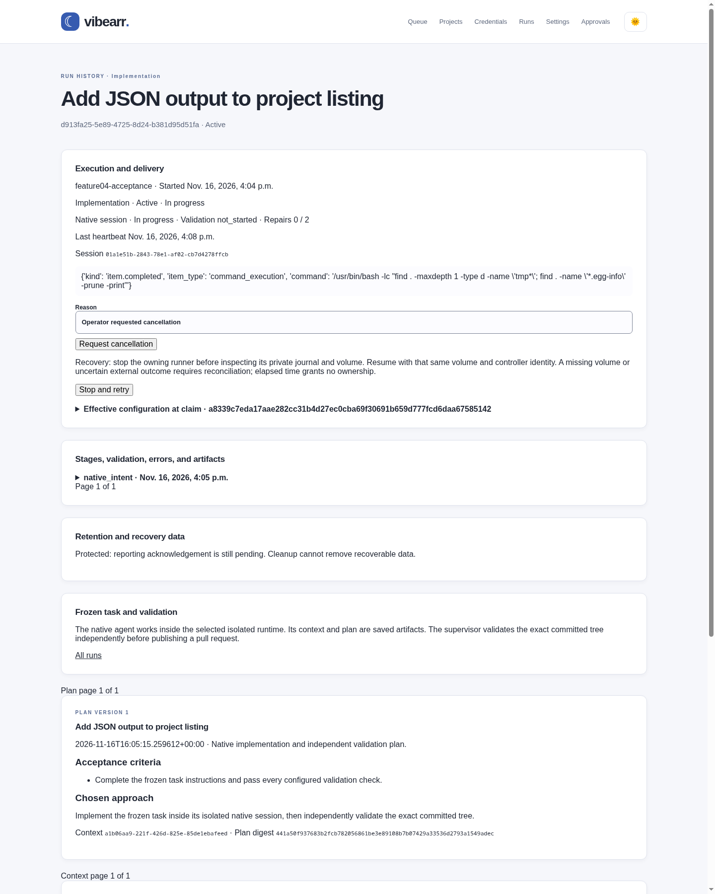
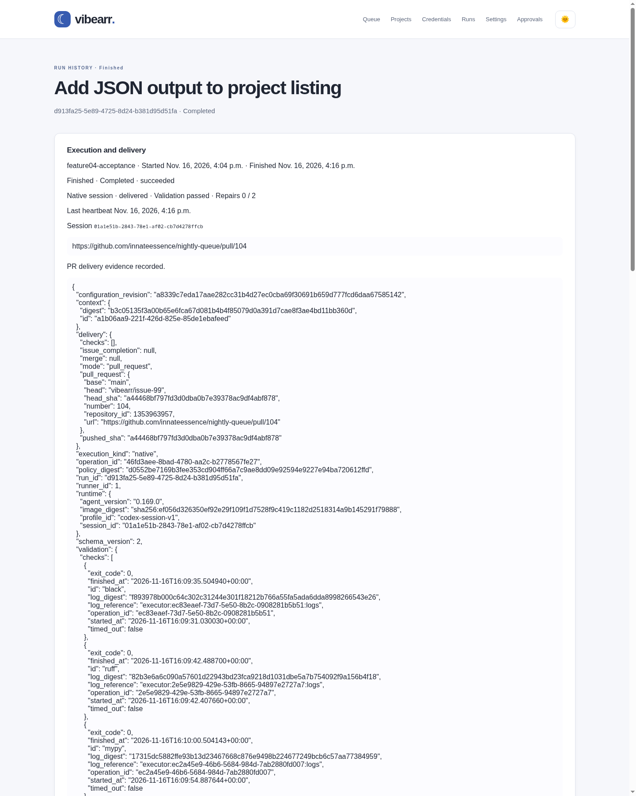

# Unattended issue-to-PR acceptance

On November 16, 2026 the normal queue processed [owner issue #99](https://github.com/innateessence/nightly-queue/issues/99) and created [PR #104](https://github.com/innateessence/nightly-queue/pull/104). The task adds machine-readable `vibearr projects --json` output while preserving the default table and the `nq` alias. No workflow files were changed.

The dedicated disposable project used a genuine enable cutoff of `2026-11-16T14:12:23.418703+00:00`. Normal import excluded older plan issues from execution. The production stack and the separate bootstrap project were untouched.

| Attempt | Run | Recorded result |
| --- | --- | --- |
| 1 | `6a16f1de-5db4-4f71-8f6c-0438715338c0` | Genuine agent completion, then explicit operator retry. The claim remained held until protected termination confirmed cancellation and requeue. No publication. |
| 2 | `6fbc4d38-60ac-41bd-ba55-e1528e350e13` | Genuine agent completion and committed candidate, then failure before publication. After the executor service exited143, the author restarted it with the wrong registry file: 11 profiles rather than the original qualified 21. Qualification correctly rejected validation. The terminal run was retained and acknowledged. |
| 3 | `d913fa25-5e89-4725-8d24-b381d95d51fa` | All nine independent OCI checks passed; one non-draft PR was delivered and the server acknowledged success. No repairs. |

The final attempt ran from an immutable full checkout of supervisor revision `24386a2d11df53e159be0b3e09e54658c31c7370`. The subsequent `push_once` correction is covered by independent transport regressions and fresh review; it was not deployed into this running acceptance. The first two attempts used earlier supervisor revisions, and the second included a diagnostic cycle while clone recovery was being developed. Their history was not reset. An initial preclaim driver interruption did not retain child stderr, so its cause remains unknown; same-journal resume preserved ownership. The final attempt completed within the explicitly bounded three-task allowance.

The restored executor retained instance `f97c5304-729d-4297-9825-8b17033f035e`, its original 21-profile registry and binding `92e51fa618bae9b92007bab09820eff8c4f43430171b97464b7ea4ef22d2a692`. Both images passed corrected Q13 qualification on executor source `bb447de81c9a7956daf800981033c0325949e316126c81ac8d975bf7c4c74b6f` before paid work. The genuine Codex session was `01a1e51b-2843-78e1-af02-cb7d4278ffcb` using CLI 0.169.0.

| Restart checkpoint | Supervisor generation | Process ID |
| --- | ---: | ---: |
| Agent completed | 83 | 2734 |
| Push verified | 165 | 77887 |
| PR verified | 166 | 79838 |
| Completion reporting pending | 167 | 81751 |

The driver recorded 169 successful cycles in fresh supervisor processes; diagnostic and interrupted cycles are additional. Historical server readback verified version 2 delivery for commit `a44468bf797fd3d0dba0b7e39378ac9df4abf878`, tree `268c088c788109c9daebef22cc887c7324b9ab8b`, all nine zero-exit check receipts, exact native operation termination and the same GitHub PR identity. Finish digest: `65583dad5cec222a323518d510afc16a9ca7013bf2227b8f6076e25b7568cd81`.

The [captured receipt](feature04-issue99.json) includes the delivery, termination, restart and attempt history. The original generated delivery document has SHA256 `46c4e00f47678fc759b0efdd54825e2638745181de7ec4e51cd9c255078ed16a`. Credentials, raw logs and source exports remain private.

This proves PR-only delivery. Provider CI/review/merge of PR #104 are separate gates; this run did not merge its own PR. A live failed-validation/repair scenario remains part of bootstrap/MVP acceptance; bounded repair and failure behavior are covered here by fixtures.

