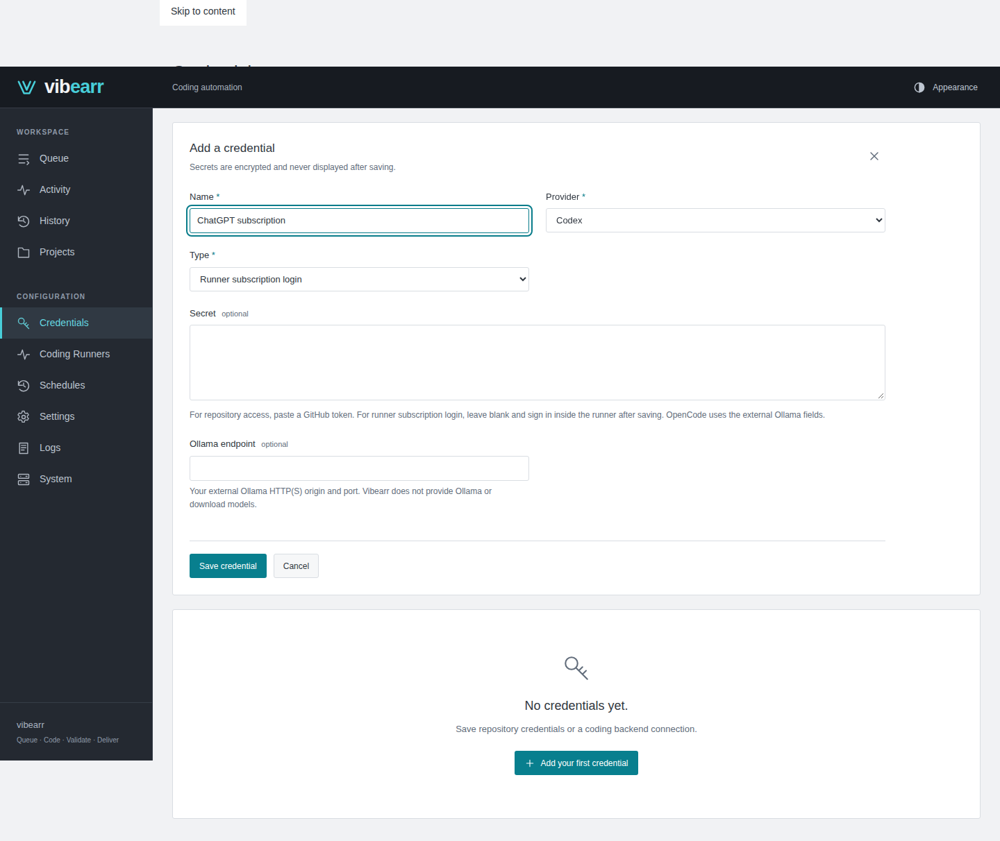

# Runner credential boundary

Runner authentication is provisioned separately with `provision_runner`.
The queue's `VIBEARR_API_TOKEN` cannot retrieve selected secrets. The runner never
receives the application's encryption key or database credentials.

Supported credential selections are:

| Purpose | Provider and type |
| --- | --- |
| Issue imports, issue reads and repository publication | GitHub token, selected separately for each purpose |
| Codex and Claude Code | Runner-managed subscription login reference |
| OpenCode | External Ollama connection and installed model |

GitLab, SSH keys, model API keys and uploaded subscription-session JSON are not
supported credential types. This revision creates a fresh schema and does not
convert older credential records.



Sign in, reconnect and log out through the
[Docker operations procedure](docker-operations.md#subscription-login). Managed
login files stay in the runner's private volume. The app stores a reference, not
the subscription tokens. A selected agent receives only its own login in a
temporary home; supported refresh is collected after descendant termination.
Trusted control and Git credentials remain inaccessible to candidate code.
Saving a selection never proves live authentication, model access or readiness.

## Selected secret API

`POST /api/v1/runner/secrets/` requires runner Bearer authentication. Preflight
selects an account already present in the authenticated configuration and requires
a `RunnerPreflightGrant` for that runner and credential:

```json
{"scope":"preflight","backend":"codex","credential_id":1}
```

GitHub preflight also requires the selected `project_id`. It returns read-only
preflight authority. An active owned run supplies its claim and a current selected
purpose:

```json
{"scope":"run","run_id":"<uuid>","claim_token":"<uuid>","purpose":"implementation"}
```

Run purposes are `implementation`, `issue` and `repository`. Reconciliation uses
`scope: "reconciliation"` and permits only registered owned native work with an
issue or repository read purpose. Selection changes, revocation, stale claims and
foreign ownership fail closed. There is no fallback to an import credential or
another project's account. Responses and errors are non-cacheable.

Successful responses contain `schema_version: 1`,
`credential: {id, provider, kind, version}` and `material: {secret}`. OpenCode
connection material is a JSON string. Subscription material identifies the managed
login; it is not an uploaded provider session. Keep secret responses outside
prompts, command lines, saved plans, evidence and logs.

## Rotation, redaction and recovery

Editing a secret increments its version only when the encrypted payload changes.
Revocation permanently blocks further delivery from that row. Create and select
replacement credentials to restore access; stop existing processes and revoke
credentials at the provider when necessary. Already delivered material cannot be recalled.

Credential changes and claim snapshots share the settings/credential lock order.
Project and retained-run references prevent accidental deletion. Previous
ciphertexts remain in the private `CredentialSecretVersion` history so reporting
can redact an earlier version after rotation. They are never returned by the
secret endpoint or exposed through configuration and evidence.

Evidence, progress and finish errors redact selected credential values and their
retained versions. Missing encryption or invalid material fails reporting closed.
Completed retries compare the saved input digest without decrypting secrets again.
Back up the encryption key, ciphertexts and private login volumes together; use
[recovery](runner-recovery.md) to retire old authority after restore.
