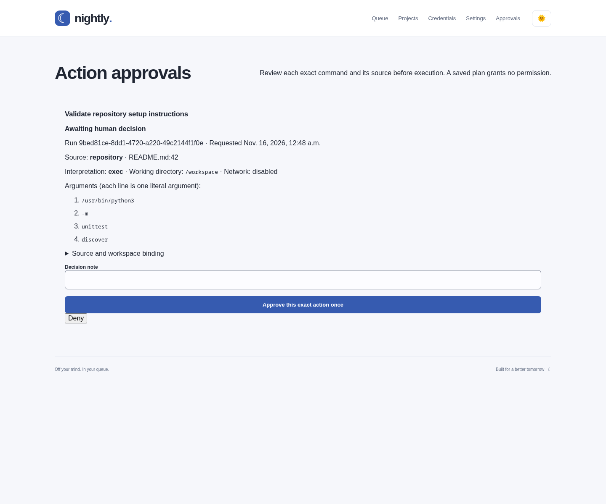

# Task workspaces and human command approvals

Execution remains disabled. These interfaces establish the boundary used by later
backend integrations; they do not start an agent or run queue work automatically.

`WorkspaceManager.prepare(run_id, claimed_item)` uses only the claim's top-level
`repository_url`, `base_branch`, and `branch_name`. An empty base resolves the
remote's default branch and records its immutable commit. Each UUID gets its own
private directory, checkout, lock, and protected metadata. Restarting preserves
changes; a changed claim or incomplete checkout requires operator recovery. A
remote task branch is preserved on retry. No reset, clean, force push, submodule
initialization, or repository setup command runs during preparation.

Supervisor Git accepts HTTPS remotes without embedded credentials. The explicit
`trusted_local_root` constructor option is only for controlled local fixture
repositories; it does not accept an arbitrary task-selected filesystem location.
Git receives argument arrays, validated ref names, a clean environment, disabled
hooks/credential helpers/external protocols/fsmonitor, and no user or system
configuration. Credentialed remote operations belong in the supervisor integration,
never in the agent sandbox. Secrets must not be written into checkout config.

## Approval contract

Every proposed command requires a human decision, including repository setup and
tests, commands copied from issues/comments/research, saved-plan commands, and
operator-origin proposals. There is no auto-approval option. A plan is data.

`ActionSpec.from_data()` requires exactly these fields:

| Field | Binding |
| --- | --- |
| `argv` | Exact argument array; executable is an absolute sandbox path |
| `mode` | `exec`, or explicit `shell` with exactly `/bin/sh`, `-c`, script |
| `source_kind` | `issue`, `comment`, `repository`, `research`, `plan`, or `operator` |
| `source_reference` | Authoritative snapshot reference, URL, or repository-relative file |
| `source_digest` | SHA-256 of current authoritative source bytes |
| `workspace_id` | Run/workspace UUID |
| `base_revision` | Inspected base commit |
| `content_digest` | SHA-256 of all visible checkout paths, bytes, modes, and symlink targets |

`ActionSpec.binding_digest` hashes canonical JSON for the complete action. There
are no caller-selectable environment variables, working directories, bind mounts,
network access, or shell interpolation defaults. An interpreter script is visible
as a literal argument. Shell scripts must use explicit shell mode; interpreter
programs and executable repository files still require the exact same human
approval and content binding.

The supervisor registers its actual fetched context/plan/research bytes with
`SourceStore.register(kind, reference, bytes)`. Never register agent-supplied bytes
as authoritative provenance. Updates replace the current digest. Repository
provenance is reread directly from the current relative workspace file and rejects
external symlinks and `.git`. The executor recomputes the complete content digest,
source digest, protected metadata, and base revision immediately before and after
obtaining a permit, under the workspace lock. Agent-provided digests alone grant
no authority. Changed source/action/content/base requires a fresh human decision.

Runner bearer authentication and an active exact claim are required for:

- `POST /api/v1/runner/runs/<uuid>/approvals/` with `claim_token`, retry-stable
  `operation_id`, and `action`: creates an immutable pending request and sets the
  run to an approval wait. Repeating the operation with changed content conflicts.
- `GET` the same collection, or `GET .../approvals/<uuid>/`: owned-run readback.
  Collection readback shows the latest 100 requests.
- `POST .../approvals/<uuid>/consume/` with `claim_token`, `binding_digest`, and
  a fresh `execution_id`: atomically consumes one approved decision. Only the
  first response grants `permit: true`. Every retry returns `permit: false`, even
  with the same execution ID. An ambiguous response must never trigger execution.

Only the CSRF-protected browser POST at `/runner/approvals/<uuid>/decision/`
records approve/deny, matching the displayed digest. Decisions are immutable;
denied, obsolete, changed, consumed, or undecided actions cannot execute. The inbox
uses the application's existing private-LAN operator access model, has no-store
responses, and escapes all untrusted content. It does not add public-user login.

`ApprovalBroker` keeps bearer/claim tokens in the supervisor and never puts them in
action proposals. `ApprovedExecutor` accepts a broker, protected source store,
fresh stage gate callable, and periodic gate callable. Exceptions and closed gates
never grant execution. Research uses `read_only=True` on the executor, which
mounts the entire checkout read-only even when a human approved a write command.
A consumed permit followed by a crash/failed spawn requires
operator reconciliation and a new approval; recovery never assumes execution was
absent. Later recovery should correlate the returned execution ID with durable
events before requesting another action.

## Enforced sandbox and backend contract

All execution goes through bubblewrap namespaces: isolated user, PID, mount,
network, IPC, UTS, and cgroup namespaces, no capabilities, no nested user
namespaces, a fresh `/proc`, `/dev`, `/tmp`, and HOME. Only `/usr`, `/lib`, and
`/lib64` from the vetted runtime image are read-only; one checkout is writable at
`/workspace`. Its `.git` is covered by an ephemeral filesystem. The supervisor's
journal, source store, API/Git/backend credentials, other tasks, host home, sockets,
and environment are absent. Inherited file descriptors close. The network
namespace has no host network. Interpreter programs receive the same boundary.
Timeouts, gate closure, and oversized output kill the sandbox; PID namespace
termination also kills detached/forked children after parent exit.

Native backend shell/file/network tools are unsupported.
`require_mediated_backend(transport="structured_proposals", native_tools=False)`
is the capability contract for future adapters: the supervisor invokes a remote
model without exposing local tools, accepts structured proposals as data, and
dispatches each approved action through `ApprovedExecutor`. A local backend CLI
with autonomous native tools must fail readiness until its actual tool protocol
can meet this contract. Merely asking a model to respect approvals is insufficient.

This boundary does not isolate malicious kernel exploits or provide a complete
resource quota. Compose's PID limit remains required. Use a vetted immutable
runtime image and do not place secrets under its shared system directories.
Dependency installation requiring network access is unsupported here and must
remain blocked until a separately reviewed mediated network design exists.

## Deployment and verification

The runner image pins Debian bubblewrap. The deployment host must support
unprivileged user, PID, mount, and network namespaces plus nested user namespaces
inside the container. Docker's default seccomp/AppArmor profile or host policy may
block them. The readiness probe fails closed before consuming a human approval.
Do not fix a failed probe with privileged mode, host namespaces, a Docker socket,
or broad capability/seccomp exceptions. A reviewed narrow host policy is a later
release requirement. The image installs Python under `/usr/local`; it is visible
read-only to sandbox commands, while supervisor credentials remain outside it.

The image was built and its real readiness probe was run with the Compose
read-only filesystem, `/tmp` tmpfs, dropped capabilities, no-new-privileges, and
PID limit. Bubblewrap 0.8.0 reported "No permissions to create new namespace".
**The current container deployment is
blocked for command execution.** Host boundary acceptance does not clear this
deployment blocker.

For a supported deployment, an administrator must review the host's namespace
policy and supply narrowly scoped container policy artifacts, for example
`/etc/nightly-queue/runner-seccomp.json` and an AppArmor profile named
`nightly-queue-runner`, through an operator-owned Compose override:

```yaml
services:
  coding-runner:
    security_opt:
      - no-new-privileges:true
      - seccomp=/etc/nightly-queue/runner-seccomp.json
      - apparmor=nightly-queue-runner
```

Those policy files are deliberately not shipped as an untested permission grant.
The reviewed policy must permit bubblewrap's namespace operations while retaining
the container's other restrictions. Verify the exact final image and policy by
running `probe_sandbox()` and the complete `coding_runner.boundary_checks` suite
inside that deployment, including cross-task and supervisor sentinel files. Also
test denial with the unmodified policy. Record the image digest, kernel, policy
digest, and results in release evidence before changing execution readiness.
No currently tested production policy is available in this branch.

Run the deterministic suites and deployment acceptance separately:

```sh
python -m unittest coding_runner.test_workspaces
python manage.py test runner_control.test_approvals
python -m unittest coding_runner.boundary_checks
python manage.py test runner_control.boundary_http_checks
```

The explicit boundary suite performs real access/process/command tests and fails
when namespaces are unavailable; it never marks missing isolation as a passing
skip. It tests cross-task/supervisor files, hidden Git metadata, inherited secrets
and descriptors, parent processes, host network, symlink escapes, literal malicious
arguments, denial, changed source/content, and forked children on timeout/exit.
Local host acceptance passed all workspace/boundary checks. PostgreSQL passed
593 integrated tests, including 17 approval/API/UI tests; the standalone CLI
passed 33 tests. The explicit HTTP boundary suite additionally uses the real
runner HTTP client, a Django live server, CSRF-protected human decisions, and
actual bubblewrap commands, including simultaneous permit consumption. These are
local deterministic results, not live provider/release acceptance.


