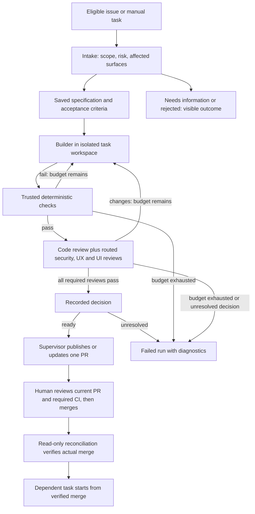

# Codex-first software factory

Revision: 2026-11-22. Planning baseline: `84ada44` on `main`.
This is the target runner workflow and implementation backlog. It does not claim
these stages exist or qualify autonomous execution. The
[Docker-only runtime contract](docker-only-runtime-plan.md) remains authoritative.

## Desired loop

The independent supervisor drives this loop from durable state. Agents perform
bounded roles and return artifacts; trusted code checks evidence and advances the
run. Codex supplies every agent role in the first implementation. Claude Code and
OpenCode later implement the same contract, including complete single-provider
pipelines. A mixed-provider configuration is optional, never a prerequisite.

Humans merge every PR through the MVP and factory rollout. Use the existing
`delivery_mode: "pull_request"`; automatic merge stays disabled. The final agent
decision recommends readiness for human review and grants no merge authority.

The [reference video](https://www.youtube.com/watch?v=RiaTyJ2POVo) and
[software-factory-claude-code-v2](https://github.com/zazencodes/zazencodes-season-3/tree/de4598a8fab54425366952d886bbdb083f075af6/src/software-factory-claude-code-v2)
set the direction. The inspected source separates intake, specification, build,
scripted checks, routed reviews and a final decision, with artifacts per round.
This proposal adapts that pattern to vibearr's services and execution policy.
The video could not be fetched during this review; detailed comparisons below
are based on the linked source, not a verified viewing of the video.

## Adaptation decisions

| Reference pattern | vibearr target |
| --- | --- |
| A Claude session orchestrates role agents | The existing standard-library supervisor schedules backend-neutral role sessions through Docker worker APIs |
| A factory label selects issues | Preserve permitted-author selection, priorities, holds and dependencies; an opt-in label filter may be configured later |
| Local job files and worktrees | PostgreSQL stores immutable display artifacts and run metadata; private named volumes hold supervisor journals and isolated snapshots |
| Script-owned state transitions | Extend the current owned-run services and operation journal; agents cannot mutate authoritative state |
| Risk and affected surfaces route reviews | Trusted routing combines intake with changed paths and configured rules; code review always runs, UI adds UX/UI, security adds security review |
| Build, gate, review rounds | One initial build plus at most two repairs by default, sharing the existing run budget with CI and base updates |
| Agent-written verdict and merge step | A role records readiness; the supervisor publishes a PR, a human merges, and read-only reconciliation verifies the resulting merge |
| Concurrent jobs and reviewers | One active task initially; execute reviewers sequentially on the existing slot, then add parallelism only with separately qualified capacity |
| Transcript-based cost display | Record measured provider usage when available; distinguish estimates from billed cost and report unavailable telemetry honestly |

Role artifacts are data. They cannot grant credentials, enable execution, change
tool permissions, select a new image, weaken checks, or bypass repository rules.
No host worktrees, user-home transcript scanning, CLI installation instructions,
or reference scripts are imported. This docs change adds no upstream code.

## Stage and artifact contract

All rows describe new orchestration to implement. Reuse existing immutable context
and plan versions where they fit; introduce explicit versioned schemas for the new
artifacts. Markdown is a display rendering, not a state-transition protocol.

| Stage / role | Required input | Required result and transition |
| --- | --- | --- |
| Intake | Frozen issue/manual-task context, configured policy, inspected base | `accept`, `needs_info`, or `reject`; scoped intent, acceptance criteria, risk, surfaces, rationale and concrete questions. Acceptance proceeds to specification; other outcomes stop this attempt after confirmed cleanup. |
| Specification | Accepted intake, repository context, base identity | Immutable specification with testable acceptance criteria, scope, exclusions and verification plan. The spec references the intake/context digests; no human plan approval. |
| Builder | Specification, current source, prior round diagnostics | Candidate snapshot and build summary mapping acceptance criteria to changes and checks. Only this role receives write access to candidate source. |
| Deterministic gate | Candidate tree, trusted validation profile, dependency artifact | Existing independent validation receipts, actual exit results and protected-path checks. A failure returns diagnostics to the builder; do not spend reviewer calls on a failing gate. |
| Required reviewers | Same gated candidate and spec, diff, check results; UI evidence where required | One structured verdict per routed role: `pass`, `changes`, or `blocked`, findings with evidence and stable IDs, acceptance-criterion coverage. Missing, malformed, failed or timed-out reviews prevent advancement. |
| Decision role | Full required review set, current gate and findings | Recorded `ready` or `unresolved` decision with rationale, from a separate agent session. It cannot waive required findings, substitute for a gate, or authorize merge. |
| Delivery / human merge | Verified artifacts, current ownership and project policy | Supervisor commit/push/PR receipts finish the run at verified delivery. A human reviews and merges through GitHub; separate read-only reconciliation records the actual merge before dependencies unlock. |

Intake may clarify or propose splitting oversized work; it cannot silently remove
requested acceptance criteria. A changed outcome requires an explicit unresolved
question or a separately tracked follow-up with its relationship recorded. Manual
tasks use the same artifact and review pipeline without requiring a GitHub issue.

Keep queue statuses `queued`, `running`, `succeeded`, and `failed`. Record the new
stages and structured outcomes on the run. `needs_info` and `reject` map to failed
attempts with distinct reasons, leaving the issue open and requiring a changed
context or explicit retry before another attempt. They must not churn on every
poll or hold the only task slot indefinitely. A reply becomes a new context and
attempt; prior artifacts remain immutable. Automatic issue comments or follow-up
creation require configured GitHub write scope and operation reconciliation.

Code review checks correctness, scope, maintainability and weakened tests. Security
review inspects trust boundaries and credential exposure. UX review checks whether
the flow meets the requested outcome; UI review inspects actual rendered evidence.
Reviewers get separate sessions, read-only source and only their registered tools.
They may request changes, but the supervisor alone decides state transitions.

Routing is saved before review and recomputed against the actual diff. Unknown
paths or ambiguous risk use conservative configured routing. A builder cannot
remove a required reviewer by describing its change as low risk. If a required
browser or reviewer capability is unavailable, the run reports the missing
capability instead of silently skipping the review. Browser execution stays in
the Docker browser job against disposable services, without production secrets.

## Rounds, authority and recovery

Each artifact binds run ID, context/spec version, round, role, operation ID,
backend/model and pinned CLI version, prompt/configuration digest, source tree,
base/head identities where applicable, timestamps and payload digest. Worker
receipts retain instance/boot identities. Persist the required reviewer set and
each role's completion separately; a summary cannot stand in for those records.

After any edit, rerun the gate and all required reviews on the new candidate.
Never carry a prior tree's pass into a later round. A changed base invalidates
affected spec, validation and review evidence; reconcile it, rebuild if needed,
and obtain fresh evidence before marking the PR ready again. Human review and
required GitHub checks apply to the actual current PR head. Protected validation
configuration
stays outside candidate control; changing it requires a separately reviewed
profile/image and qualification, not a builder exception.

Count the initial build as round 1. At most two repair sessions follow by default;
test failures, reviewer requests, CI failures and base changes spend the same
repair budget. Transport retries keep their operation identity and do not grant
another model session. Charge all roles to aggregate agent time, account capacity
and configured reserve limits; use stage deadlines within the existing run
deadline. An unresolved decision ends with useful evidence rather than spawning
unbounded judges or resetting the budget. Optional human feedback starts an
explicit new attempt; it is not a command/plan approval step in routine work.

Journal each role operation before dispatch. After a restart or lost response,
query that operation and worker boot before resuming. Resume remaining reviewers
only after reconciling completed and uncertain operations. Heartbeat age, a
missing artifact or a model's final message never proves process termination.
Unknown operations keep their fence; confirmed failures release capacity.
Pause/cancel covers every active role and browser/check job, with descendant
termination confirmed before slot reuse. GitHub writes reconcile their original
operation and repository/branch/head; a retry reuses the same PR identity.

After delivery, mark the attempt `succeeded` with outcome `delivered` and release
its claim and worker capacity. Display the PR as awaiting human review separately
from the finished run. Independent work may continue; dependent work stays blocked.
A read-only reconciliation path, using currently authorized project read scope
rather than the completed claim, verifies repository/PR/head, actual merge SHA and
base ancestry before recording dependency completion. PR creation, a readiness
verdict, issue closure, or a closed-unmerged PR never satisfies a dependency.
Late CI failures remain visible; a repair after delivery requires an explicit new
attempt and reuses the existing PR, without resurrecting the finished claim.

## Container footprint and consolidation review

The factory needs role sessions, not a container per role. Reuse the existing
agent slot sequentially for intake, spec, build, reviews and decision, with a
confirmed reset and the appropriate role permissions between sessions.

Rendered Compose with the `runner` profile at baseline `84ada44` defines 14
long-running services and two one-shot startup jobs (`initialize`, `migrate`).
The separate `feat/docker-codex-account` branch adds account service/proxy
isolation, bringing its topology to 16 long-running services plus those startup
jobs. This is a configured service count, not evidence that services are running.

| Responsibility | Baseline main | With account branch |
| --- | --- | --- |
| Web, production PostgreSQL, Valkey, importer, scheduler | 5 | 5 |
| Agent, setup and validation workers | 3 | 3 |
| Isolated agent and validation test PostgreSQL | 2 | 2 |
| Supervisor and authenticated worker gateway | 2 | 2 |
| Model and package proxies | 2 | 2 |
| Codex account service and account proxy | 0 | 2 |
| Long-running total | 14 | 16 |

Tools, qualification, browser, backup and restore jobs are additional one-shot
operations. Claude/OpenCode do not require running three provider fleets together.
Parallel role execution would need separately qualified capacity and is deferred.

Before finalizing the installation footprint, review which processes truly need
separate containers and which can share a trust boundary or run only when needed.
Measure idle and active resource use and compare operator complexity. Record a
smaller topology proposal and its qualification work before changing Compose;
preserve independent checks, production/test separation, credential isolation,
egress restrictions, reset guarantees and the socketless Docker boundary. The
current 14/16-service layout is an implementation baseline, not a fixed factory
requirement or a claim that consolidation is already proven safe.

## Current code and implementation ownership

The baseline contains the queue, issue selection, settings/schedules, immutable
context/plans, native Codex lifecycle, Docker slots, independent validation,
delivery/merge and recovery code. Its recorded
[Docker progress](docker-only-progress.json) explicitly leaves autonomous execution
unqualified. Existing functionality must be adapted and requalified; its presence
does not establish the new pipeline or live readiness.

| Owner | Extend |
| --- | --- |
| `runner_control/` | Run stage/outcome schema, immutable role/round artifacts, owned APIs, required-review set and transition validation, display evidence |
| `vibearr_runner/` | Existing native lifecycle, backend registry, role dispatch, trusted routing, shared budgets, journals, artifact import and delivery/merge prerequisites |
| `vibearr_executor/` | Registered role capabilities, read-only reviewer inputs, source/credential separation, authenticated worker receipts and cleanup |
| `work_queue/services.py` | Shared eligibility, terminal transitions and retry/context behavior; preserve generic API clients |
| `projects/`, `credentials/` | Versioned project routing/model overrides and explicitly selected backend connections; snapshot them at claim |
| Existing app views and Docker jobs | Activity/History round evidence, browser artifacts, qualification and CI |

Do not build a second queue, a Django-dependent supervisor, or a separate factory
dashboard/service. The standalone HTTP CLI stays independent of the runner and DB.
Keep compatibility imports in `coding_runner/` and `nq/` intact during migration.

## Branch sequence and acceptance

Create each feature on its own branch from updated `main` after prerequisites
merge. F IDs extend the [existing roadmap](autonomous-ai-queue-plan.md); they do
not renumber completed features. These are proposed branches, not existing PRs.
Implementation can proceed while Docker release acceptance is pending; live
qualification requires the qualified target worker stack and selected connection.

| ID / proposed branch | Depends on | Reviewable result and acceptance |
| --- | --- | --- |
| F1 `feat/factory-role-contracts` | Existing owned runs, native protocol | Versioned role/round artifacts, stage/outcome migrations, required-role sets, configuration snapshots and idempotent APIs. Reject stale ownership, conflicting replay, invalid transitions and artifacts for another tree/round. Preserve old history and generic queue clients. |
| F2 `feat/codex-intake-spec` | F1, native Codex | Codex intake/spec sessions through Docker; accepted work has saved criteria, unanswered questions and rejected work produce distinct outcomes without occupying capacity or repeated automatic retries. Test manual tasks and context-change retries. |
| F3 `feat/codex-build-review-loop` | F2, independent validation | Builder, gate, trusted routing and separate code/security/UX/UI reviewer sessions; read-only reviewer source, fresh evidence, complete review barrier and shared repair budget. Demonstrate test failure repair, review-request repair and honest exhaustion; a missing reviewer blocks delivery. |
| F4 `feat/factory-delivery-recovery` | F3, existing delivery/reconciliation | Recorded decision and server-enforced delivery prerequisites, one PR, claim release at delivery, and read-only human-merge reconciliation. Test lost dispatch/push/PR responses, late/stale reviews, changed base, confirmed cleanup, unrelated work while review waits, and no runner merge request. |
| F5 `feat/factory-activity-evidence` | F4 | Activity/History show scope, spec, risk, required reviewers, round findings, check/browser evidence, decision, time/usage availability and PR/merge. Docker browser acceptance covers desktop/mobile, missing data and failed/recovered runs. |
| F6 `test/codex-factory-acceptance` | F5, D1–D4 target qualification, usable Codex auth | Actual Docker Codex two-dependent-issue scenario with a human merging each PR, artifact chain, a routed UI/security case, bounded repair, cancellation and restart evidence. Record images, CLI/profile identities, trees, human merge actors and ancestry; verify zero runner merge calls. Fixtures alone cannot qualify this milestone. |
| F7 `feat/claude-factory-roles` | F6, native Claude feature 08 | Claude-only pipeline passes the shared role conformance suite and genuine Docker auth/tool/read-only-review/cancel/resume acceptance, then its own two-issue loop. |
| F8 `feat/opencode-factory-roles` | F6, native OpenCode feature 09 | OpenCode-only pipeline passes the same suite and genuine Docker acceptance for its pinned CLI/provider/model, then its own two-issue loop; Ollama remains an optional separately verified connection. |

F7 and F8 may proceed independently after F6. Each provider needs role-specific
structured results, noninteractive tools, durable operation identity, termination
and capability probes. Do not equate a native adapter PR, API transport, or an
advertised capability with factory conformance. Model selection is configured
per role; do not hard-code the reference's model names or assume equivalent quota
and resume interfaces across providers.

The existing two-issue Codex MVP remains the runtime/delivery prerequisite. F6 is
the expanded factory milestone: both issues traverse intake/spec/build/gate/review/
decision, a human merges each PR, B starts from A's verified merge, and the same
run evidence appears in Activity/History. There are no manual command or plan
approval prompts; human PR review and merge are required for every provider.
Automatic deployment remains later feature 12; multi-task/parallel-review capacity
remains feature 13 with an explicit qualified slot budget.

## Later automatic merge: maturity gate

Automatic merge is outside the MVP, F1–F8 and their acceptance criteria. Existing
merge code and earlier signoffs do not authorize its use. Keep delivery mode
`pull_request` and GitHub auto-merge disabled; no agent role may merge or enable it.

Revisit feature 07 only after sustained human-reviewed operation across real
changes demonstrates reliable scope, check/review quality, dependency handling,
and recovery. Track escaped defects, human corrections/rejections, false passes,
repair exhaustion and duplicate-side-effect incidents. An operator must agree
evaluation thresholds and a representative observation period, review the actual
results and unresolved incidents, and explicitly approve a separate limited
rollout. Passing F6, elapsed time or an agent readiness decision cannot enable it.
That later change must include current-head CI/review enforcement, compatible
repository protection without bypass, opt-in per-project scope, audit evidence,
and a tested immediate return to human merging. Required human reviews must never
be removed or bypassed automatically. Automatic deployment remains independent.

## Source notes

Reference inspection used factory revision `de4598a8fab54425366952d886bbdb083f075af6`:
[README](https://github.com/zazencodes/zazencodes-season-3/blob/de4598a8fab54425366952d886bbdb083f075af6/src/software-factory-claude-code-v2/README.md),
[design](https://github.com/zazencodes/zazencodes-season-3/blob/de4598a8fab54425366952d886bbdb083f075af6/src/software-factory-claude-code-v2/DESIGN.md),
[orchestrator workflow](https://github.com/zazencodes/zazencodes-season-3/blob/de4598a8fab54425366952d886bbdb083f075af6/src/software-factory-claude-code-v2/.claude/skills/factory/SKILL.md),
and [routing configuration](https://github.com/zazencodes/zazencodes-season-3/blob/de4598a8fab54425366952d886bbdb083f075af6/src/software-factory-claude-code-v2/factory/config.json).
The adaptation choices and F1–F8 contracts above are proposed vibearr design.
Provider commands and capabilities must be verified against the versions pinned
by the existing native-adapter work before implementation.
